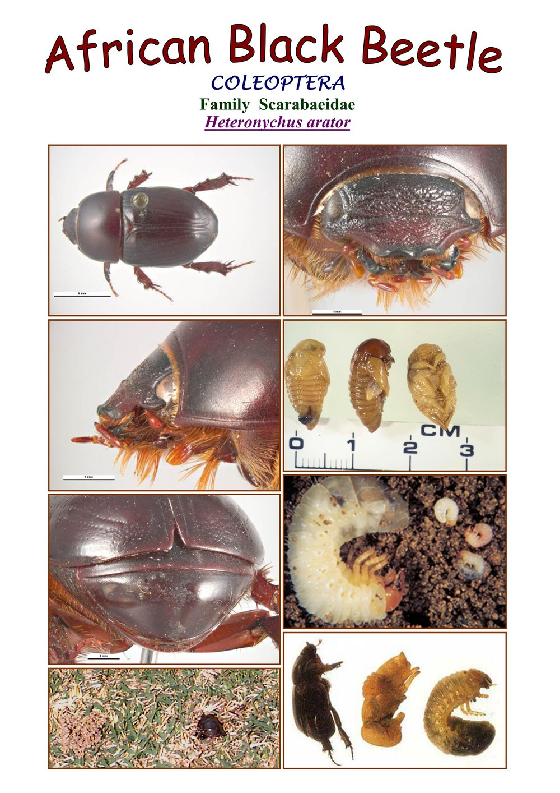

# PandD ID Trainer 🃏

**Learn your Pest & Disease identifications the easy way** — Tinder-style swipe
flashcards built from 87 real identification profile sheets. The card shows the
sheet with the name hidden (just like the exam); flip it to check yourself.

Preview — the answer side of a card:

## Get the app

### 📱 Android (this page)

1. Download **PandD-Flashcards.apk** from the
   [Releases page](https://github.com/s4me4su/PandD_ID/releases/tag/card-flipper)
   *(under "PandD" → Assets)*.
2. Open the downloaded file. Your phone will say something scary like
   *"unknown source"* or *"not verified by Play Protect"* —
   **this is normal** for every app installed outside the Play Store.
   Choose **Allow** / **Install anyway**.
3. Find **PandD ID Trainer** in your app drawer and open it.

### 🌐 No install? Play it in your browser

Works on any phone, tablet or computer:

👉 **https://s4me4su.github.io/pandd-flashcards/**

*(First load takes ~30 seconds because the card photos are big — after that it
opens quickly, even offline.)*

## How to study

| Action | Meaning |
|---|---|
| **Tap a card** | Flip it over to see the name & details |
| **Swipe right** (or green ✓) | "I know this one" |
| **Swipe left** (or red ✗) | "Not sure" — saved for your review round |
| **Trash icon** | Remove a card you've totally mastered |
| **"All ▾" (top bar)** | Filter: All 87, Exam 71, or a group like Fungi or Beetles |
| **Refresh icon (top right)** | Start fresh — removed cards come back |

When you finish, you get a summary of everything you marked "not sure", so
you can reshuffle and drill only the ones you keep getting wrong.

Your progress saves **automatically** — close the app whenever you like,
it picks up where you left off.

## Common questions

**Why does my phone warn me about the app?**
Google only "trusts" apps from the Play Store. This app isn't on the Play
Store (it's a study tool for our class), so Android warns you by default.
Nothing to worry about.

**Does it need internet?**
The app works fully offline. The web version needs internet only for the
first load.

**Is my progress shared with anyone?**
No. Saves live on your own device — there are no accounts, no logins, and
nothing is collected.

**How many cards are there?**
87 total. 71 of them match the official exam study list ("Exam" filter);
the rest are extras from the profile sheets.

---

*Built with Flutter from the PandD identification profile sheets. The web
version's source and full docs live in the
[pandd-flashcards repo](https://github.com/s4me4su/pandd-flashcards).*
